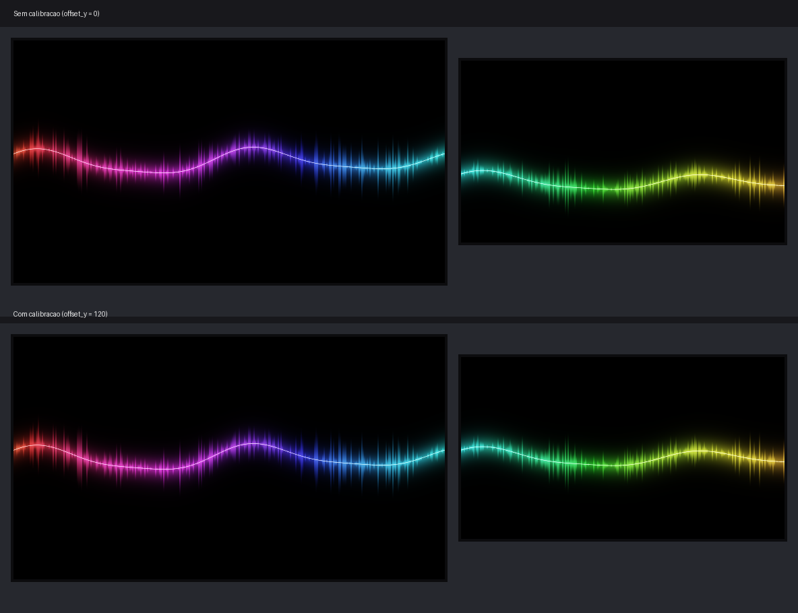

# ginga-wallpaper

> *Ginga*: the constant, flowing sway at the heart of capoeira.

Lightweight animated wallpaper for Windows 11, built for multi-monitor setups
where the screens are **not physically aligned**.



## Features (v1.0)

- Procedural light-wave shader (GPU, no video decoding)
- One continuous canvas across all monitors
- **Monitor alignment**: a visual mode with guide lines lines up monitors that
  sit at different heights on the desk, so the image flows across the bezel
- Lives behind the desktop icons (Windows 11 24H2+ and older layouts)
- Pauses itself while a game or video runs fullscreen
- Tray menu: pause, settings, align monitors, about, quit
- Settings window with live preview (speed, wave height, glow, texture, FPS)
  and "start with Windows"
- Single standalone `ginga.exe`, no install needed

## Install

1. Download `ginga.exe` from the [latest release](https://github.com/felipefernandes/ginga-wallpaper/releases/latest).
2. Put it in a permanent folder (e.g. `%LOCALAPPDATA%\Programs\ginga`) and run it.
   Windows SmartScreen may warn because the exe is not signed: *More info → Run anyway*.
3. Right-click the wave icon in the tray:
   - **Alinhar monitores…** (align monitors): arrows move the image on the
     selected monitor until the guide lines are continuous (Shift = 10 px,
     Tab = next monitor, Space = freeze the wave, Enter = save, Esc = cancel).
   - **Configurações…** (settings): tweak the look and tick
     *Iniciar com o Windows* to start with Windows.

Logs: `%APPDATA%\ginga\ginga.log`.

## Development

Requires Python 3.12+.

```bash
python -m venv .venv
.venv\Scripts\activate          # Windows
pip install -e ".[dev]"
pytest
python -m ginga                 # run the app from source
```

Build `dist/ginga.exe`:

```bash
pip install -e ".[build]"
python scripts/build_exe.py
```

Render previews offline (simulates a monitor that sits lower than the other):

```bash
python scripts/preview.py --out preview
```

## Configuration

Edited through the Settings window; stored at `%APPDATA%\ginga\config.toml`:

```toml
[render]
fps = 30
pause_when_fullscreen = true

[wave]
speed = 1.0
amplitude = 1.0
glow = 1.0
spikes = 1.0

[offsets.2]   # monitors are numbered left to right
x = 0
y = 120
```

## Roadmap

- **v2**: audio-reactive mode ("modo berimbau"): the wave dances to the PC's audio.
- **v3**: use any wallpaper (images first, then video/GIF) spanning the
  monitors with the same alignment.

Made by Felipe Fernandes.
